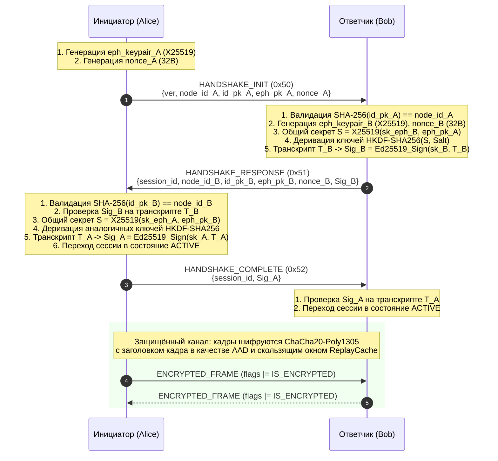

# Спецификация протокола P2P оверлейной сети

**Версия**: 0.1.0 (черновик)

## 1. Формат кадра

Каждое сообщение между узлами инкапсулировано в кадр с фиксированным заголовком
(24 байта) и переменным payload (CBOR).

### 1.1. Заголовок кадра

```
 0                   1                   2                   3
 0 1 2 3 4 5 6 7 8 9 0 1 2 3 4 5 6 7 8 9 0 1 2 3 4 5 6 7 8 9 0 1
+-+-+-+-+-+-+-+-+-+-+-+-+-+-+-+-+-+-+-+-+-+-+-+-+-+-+-+-+-+-+-+-+
|    version    |     type      |            flags              |
+-+-+-+-+-+-+-+-+-+-+-+-+-+-+-+-+-+-+-+-+-+-+-+-+-+-+-+-+-+-+-+-+
|                                                               |
+                         request_id                            +
|                       (16 bytes / 128 bits)                   |
+                                                               +
|                                                               |
+                                                               +
|                                                               |
+-+-+-+-+-+-+-+-+-+-+-+-+-+-+-+-+-+-+-+-+-+-+-+-+-+-+-+-+-+-+-+-+
|                       payload_length                          |
+-+-+-+-+-+-+-+-+-+-+-+-+-+-+-+-+-+-+-+-+-+-+-+-+-+-+-+-+-+-+-+-+
|                         payload ...                           |
+-+-+-+-+-+-+-+-+-+-+-+-+-+-+-+-+-+-+-+-+-+-+-+-+-+-+-+-+-+-+-+-+
```

| Поле | Смещение | Размер | Описание |
|---|---:|---:|---|
| `version` | 0 | 1 байт | Версия протокола (текущая: `1`) |
| `type` | 1 | 1 байт | Тип сообщения (см. §1.2) |
| `flags` | 2 | 2 байта | Флаги кадра, network byte order |
| `request_id` | 4 | 16 байт | Уникальный ID для сопоставления запрос/ответ |
| `payload_length` | 20 | 4 байта | Длина payload, network byte order |
| `payload` | 24 | переменный | CBOR-кодированные данные или ciphertext |

**Ограничения**:
- `MAX_FRAME_PAYLOAD = 65536` байт
- `payload_length` проверяется **до** выделения буфера
- Неизвестная версия → кадр отклоняется

### 1.2. Типы сообщений

| Код | Имя | Направление | Описание |
|---:|---|---|---|
| `0x01` | PING | → | Проверка доступности |
| `0x02` | PONG | ← | Ответ на PING |
| `0x10` | FIND_NODE_REQUEST | → | Запрос ближайших к target узлов |
| `0x11` | FIND_NODE_RESPONSE | ← | Список k ближайших контактов |
| `0x12` | STORE_REQUEST | → | Сохранение записи на узле |
| `0x13` | STORE_RESPONSE | ← | Подтверждение сохранения |
| `0x14` | FIND_VALUE_REQUEST | → | Поиск записи по ключу |
| `0x15` | FIND_VALUE_RESPONSE | ← | Запись или ближайшие контакты |
| `0x20` | TUNNEL_BUILD | → | Запрос на включение в туннель |
| `0x21` | TUNNEL_BUILD_OK | ← | Подтверждение участия |
| `0x22` | TUNNEL_BUILD_FAIL | ← | Отказ участия |
| `0x30` | TUNNEL_DATA | → | Данные через туннель |
| `0x31` | TUNNEL_ACK | ← | Подтверждение приёма |
| `0x32` | TUNNEL_CLOSE | → | Закрытие туннеля |
| `0x33` | TUNNEL_HEARTBEAT | ↔ | Проверка живости туннеля |
| `0x40` | APP_MESSAGE | → | Прикладное сообщение |
| `0x41` | APP_ACK | ← | Подтверждение доставки |
| `0x42` | APP_FILE_META | → | Метаданные файла |
| `0x43` | APP_FILE_BLOCK | → | Блок файла |
| `0x44` | APP_FILE_ACK | ← | Подтверждение блока |
| `0x45` | APP_FILE_COMPLETE | ← | Файл получен полностью |
| `0x50` | HANDSHAKE_INIT | → | Начало AKE-handshake |
| `0x51` | HANDSHAKE_RESPONSE | ← | Ответ AKE |
| `0x52` | HANDSHAKE_COMPLETE | → | Завершение AKE |
| `0xFF` | ERROR | ← | Ошибка |

### 1.3. Флаги

| Бит | Имя | Описание |
|---:|---|---|
| 0 | `IS_RESPONSE` | Кадр является ответом на запрос |
| 1 | `IS_ERROR` | Payload содержит описание ошибки |
| 2 | `IS_ENCRYPTED` | Payload зашифрован AEAD |
| 3 | `IS_FRAGMENT` | Payload является фрагментом |
| 4 | `HAS_MORE` | Следуют ещё фрагменты |

### 1.4. Сериализация payload

Payload кодируется в CBOR (RFC 8949). Для каждого типа сообщения определена
CBOR-структура (map). Примеры:

**PING payload**:
```cbor
{
  "node_id": h'<32 bytes>',     # NodeID отправителя
  "public_key": h'<32 bytes>'   # Ed25519 public key
}
```

**FIND_NODE_REQUEST payload**:
```cbor
{
  "target": h'<32 bytes>',      # Искомый NodeID
  "sender_id": h'<32 bytes>'    # NodeID отправителя
}
```

**FIND_NODE_RESPONSE payload**:
```cbor
{
  "contacts": [
    {
      "node_id": h'<32 bytes>',
      "host": "10.0.1.5",
      "port": 9000
    },
    ...
  ]
}
```

## 2. Идентичность

- Алгоритм: Ed25519
- `NodeID = SHA-256(public_key)` (32 байта)
- Закрытый ключ хранится в `<data_dir>/identity.key`
- Открытый ключ — в `<data_dir>/identity.pub`
- При получении ключа удалённого узла обязательна проверка `NodeID == SHA-256(pk)`

## 3. Распределённое хранение в DHT (Stage 3)

### 3.1. Формат `NodeRecord` (E3-1)

Структура `NodeRecord` описывает подписанный профиль узла или псевдонима:

```cbor
{
  "node_id": h'<32 bytes>',
  "identity_public_key": h'<32 bytes>',
  "addresses": [
    {"host": "127.0.0.1", "port": 9001}
  ],
  "alias": "alice-node",                   # Опциональный псевдоним (E3-8)
  "sequence_number": 42,                   # Монотонный счётчик версий (E3-6)
  "issued_at": 1695000000,                 # Unix timestamp выпуска (сек)
  "expires_at": 1695000180,                # Unix timestamp истечения TTL (сек)
  "signature": h'<64 bytes>'               # Ed25519 подпись канонических байтов
}
```

### 3.2. Каноническое представление для подписи (`canonical_bytes`)

Для обеспечения детерминированности формирования и верификации цифровой подписи Ed25519 используется строго специфицированный бинарный формат без подписи:

```
+-------------------------------------------------------------------+
| node_id (32 bytes)                                                |
+-------------------------------------------------------------------+
| identity_public_key (32 bytes)                                    |
+-------------------------------------------------------------------+
| sequence_number (uint64-be, 8 bytes)                              |
+-------------------------------------------------------------------+
| issued_at (uint64-be, 8 bytes)                                    |
+-------------------------------------------------------------------+
| expires_at (uint64-be, 8 bytes)                                   |
+-------------------------------------------------------------------+
| alias_length (uint16-be, 2 bytes) | alias (UTF-8 bytes)           |
+-------------------------------------------------------------------+
| addresses_count (uint16-be, 2 bytes)                              |
+-------------------------------------------------------------------+
| [for each address]:                                               |
| host_length (uint16-be, 2 bytes) | host (UTF-8) | port (uint16-be)|
+-------------------------------------------------------------------+
```

### 3.3. Валидация записи (E3-2)

Перед сохранением в локальное хранилище или использованием запись проходит полную верификацию:
1. `node_id == SHA-256(identity_public_key)` (связка идентичности, `IdentityMismatch`).
2. Верификация цифровой подписи `crypto_sign_verify_detached(signature, canonical_bytes, identity_public_key)` (`InvalidSignature`).
3. Проверка временного окна:
   - `current_time + 30s >= issued_at` (защита от записей из будущего, допуск рассинхронизации 30 с, `NotYetValid`).
   - `current_time <= expires_at` (строгая проверка истечения срока действия TTL, `Expired`).
4. Формат адресов: список адресов не пуст (`EmptyAddresses`), host не пуст, port != 0 (`InvalidAddress`).
5. Допустимый размер: alias ≤ 256 байт, addresses ≤ 16 записей (`InvalidSize`).
6. Монотонность версии: `new.sequence_number > old.sequence_number` (защита от отката, `RollbackDetected`).

### 3.4. Вычисление детерминированных DHT-ключей (E3-8)

- **Ключ адресной записи узла**:
  $$\text{Key}_{\text{node}} = \text{SHA-256}(\text{"node:"} \,||\, \text{NodeID})$$
- **Ключ псевдонима (alias)**:
  $$\text{Key}_{\text{alias}} = \text{SHA-256}(\text{"alias:"} \,||\, \text{normalize}(\text{alias}))$$
- **Нормализация псевдонима**: удаление начальных и завершающих пробельных символов, перевод в нижний регистр (ASCII case-fold).

### 3.5. RPC-сообщения `STORE` и `FIND_VALUE` (E3-3)

#### STORE_REQUEST (`0x12`)
```cbor
{
  "key": h'<32 bytes>',
  "record": <NodeRecord CBOR>,
  "sender": {
    "node_id": h'<32 bytes>',
    "address": {"host": "127.0.0.1", "port": 9001}
  }
}
```

#### STORE_RESPONSE (`0x13`, flag `IS_RESPONSE`)
```cbor
{
  "key": h'<32 bytes>',
  "success": true,
  "message": "Stored successfully"
}
```

#### FIND_VALUE_REQUEST (`0x14`)
```cbor
{
  "key": h'<32 bytes>',
  "sender": {
    "node_id": h'<32 bytes>',
    "address": {"host": "127.0.0.1", "port": 9001}
  }
}
```

#### FIND_VALUE_RESPONSE (`0x15`, flag `IS_RESPONSE`)
Если запись присутствует в хранилище хранителя:
```cbor
{
  "key": h'<32 bytes>',
  "has_value": true,
  "record": <NodeRecord CBOR>
}
```
Если запись отсутствует у хранителя, возвращаются $k$ ближайших к `key` контактов:
```cbor
{
  "key": h'<32 bytes>',
  "has_value": false,
  "closest_nodes": [
    {
      "node_id": h'<32 bytes>',
      "address": {"host": "127.0.0.1", "port": 9002}
    }
  ]
}
```

### 3.6. Репликация и кворум (E3-4, E3-5)

- **Коэффициент репликации**: $R = 3$ ближайших к ключу узла в DHT.
- **Кворум подтверждения**: операция `STORE` признаётся успешной при получении не менее $Q = 2$ подтверждений ($\min(2, \text{число доступных хранителей})$).
- **Устойчивость к отказам (E3-5)**: при выходе из строя 1 из 3 хранителей процедура итеративного `FIND_VALUE` автоматически обращается к оставшимся хранителям в shortlist кандидатов и успешно извлекает запись без ручной перенастройки адресов.

### 3.7. Жизненный цикл и обслуживание записей (E3-6, E3-7)

- **TTL записи**: по умолчанию 180 секунд (`config.dht.record_ttl_sec`). Истёкшие записи не выдаются по `FIND_VALUE`.
- **Фоновая очистка**: таймер на каждом узле периодически (каждые 15–30 с) вызывает `purge_expired()` для удаления просроченных записей из оперативной памяти.
- **Периодическое переопубликование**: узел-владелец каждые 80 секунд ($\le \text{TTL} / 2$) выпускает обновлённую версию своей записи с инкрементированным `sequence_number`, новым временем действия и свежей подписью Ed25519, распространяя её по $R = 3$ хранителям.

---

## 4. Протокол AKE и защита сессий (Stage 4)

### 4.1. Обзор протокола

Собственный протокол AKE (Authenticated Key Exchange) решает задачу взаимной аутентификации узлов и установления защищённого симметричного канала связи без использования внешних удостоверяющих центров (PKI / CA) и TLS.

Протокол обеспечивает:
- **Взаимную аутентификацию (Mutual Authentication)** на базе долговременных ключей Ed25519;
- **Прямую секретность (Forward Secrecy)** за счёт эфемерного обмена Диффи-Хеллмана на кривой Curve25519 (X25519, RFC 7748);
- **Деривацию сессионных ключей** по стандарту HKDF-SHA256 (RFC 5869);
- **Защиту от атак посредника (MITM)** за счёт включения всех параметров рукопожатия в криптографически подписываемые транскрипты $T_B$ и $T_A$;
- **Симметричное шифрование кадров** ChaCha20-Poly1305 (RFC 8439) с аутентификацией 24-байтного заголовка кадра в качестве AAD;
- **Защиту от повторов (Anti-Replay)** на базе скользящего окна `ReplayCache` (256 пакетов).

### 4.2. Схема сообщений рукопожатия



### 4.3. Канонические бинарные транскрипты

#### Транскрипт ответчика $T_B$ (287 байт)
```
"P2P-AKE-V1-RESP" (15B)
|| init.node_id (32B)
|| init.identity_public_key (32B)
|| init.ephemeral_public_key (32B)
|| init.nonce (32B)
|| resp.session_id (16B)
|| resp.node_id (32B)
|| resp.identity_public_key (32B)
|| resp.ephemeral_public_key (32B)
|| resp.nonce (32B)
```

#### Транскрипт инициатора $T_A$ (302 байта)
```
"P2P-AKE-V1-COMP" (15B)
|| T_B (287B)
```

### 4.4. Деривация сессионных ключей (HKDF-SHA256)

1. **Extract**:
   $$Salt = Nonce_A \parallel Nonce_B \quad (64\text{ байта})$$
   $$PRK = \text{HMAC-SHA256}(Salt, S) \quad (32\text{ байта})$$
2. **Expand**:
   $$OKM = \text{HKDF-Expand}(PRK, \text{"p2p-ake-session-keys-v1"}, 64)$$
   - `key_a_to_b` = $OKM[0..31]$ (32 байта)
   - `key_b_to_a` = $OKM[32..63]$ (32 байта)

Для Инициатора (Alice): $TX = key\_a\_to\_b$, $RX = key\_b\_to\_a$.
Для Ответчика (Bob): $TX = key\_b\_to\_a$, $RX = key\_a\_to\_b$.

### 4.5. Формат зашифрованного кадра и защита от повторов

Полезная нагрузка зашифрованного кадра (флаг `FrameFlags::IS_ENCRYPTED = 0x0004`):
```
+-------------------------------------------------------------+
| sequence_number (uint64-be, 8 байт)                         |
+-------------------------------------------------------------+
| ChaCha20-Poly1305 Ciphertext (variable length)              |
+-------------------------------------------------------------+
| Poly1305 Authentication Tag (16 байт)                       |
+-------------------------------------------------------------+
```

1. **Формирование 12-байтного nonce**:
   `0x00000000` (4 нуля) $\parallel$ `sequence_number` (uint64-be, 8 байт).
2. **AAD (Additional Authenticated Data)**:
   24 байта оригинального заголовка кадра (`version`, `type`, `flags`, `request_id`, `payload_length`). Защищает заголовок кадра от подмены типа или флагов злоумышленником.
3. **Фильтрация повторов (`ReplayCache`)**:
   Скользящее окно 256 пакетов на базе битовой маски. Пакеты старше окна отбрасываются, дубликаты внутри окна строго отклоняются (`ReplayDetected`).

## TODO

- [x] §4. Протокол AKE-handshake (транскрипт, деривация ключей)
- [ ] §5. Протокол построения туннеля
- [ ] §6. Протокол передачи файлов
